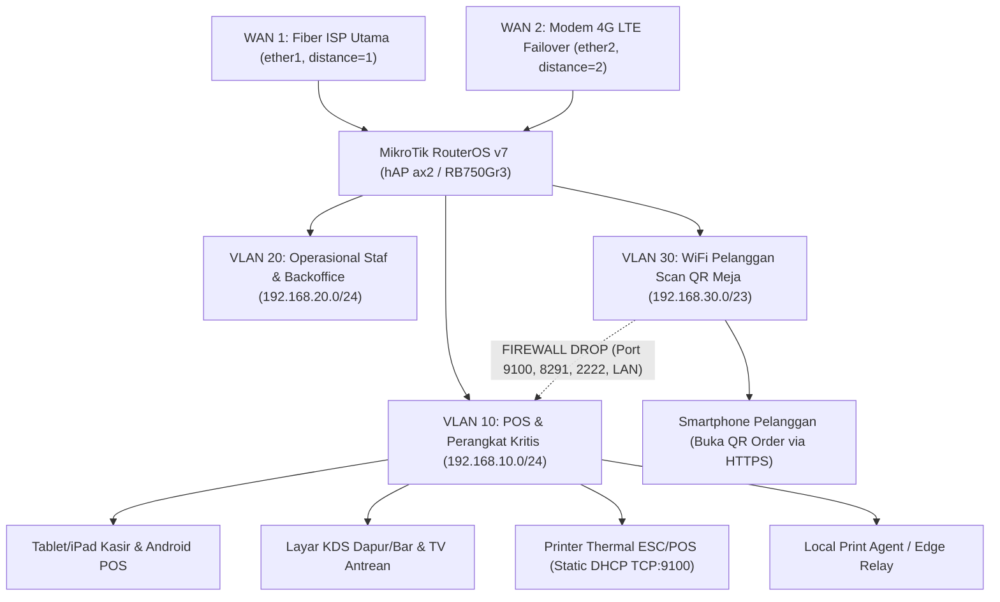

# Arsitektur Jaringan Hybrid Cloud-to-LAN, Otomasi MikroTik RouterOS v7, & Keamanan Operasional Gerai

Dokumen ini merinci standar jaringan lokal (LAN) dan koneksi internet (WAN) untuk setiap tenant **MyCaffe** (`online.abbdullaziz.mycaffe`), mencakup segmentasi VLAN MikroTik, panduan anti-salah-konfigurasi Winbox, kebijakan transfer berkas SFTP-only (FileZilla), serta sinkronisasi transaksi saat internet terputus (Offline-First).

## 1. Denah Topologi Jaringan Gerai (3-VLAN Segmentation + Dual-WAN Failover)

## 2. Standar Keamanan & Kestabilan Jangka Panjang

1. **Isolasi Ketat WiFi Tamu (`VLAN 30` -> `VLAN 10` DROP)**:
   - Pelanggan yang memindai QR meja terhubung ke `VLAN 30` (`192.168.30.0/23`, mendukung hingga 510 perangkat tamu dengan lease DHCP singkat 2 jam).
   - Firewall RouterOS memblokir total paket dari `VLAN 30` menuju `VLAN 10` (printer thermal TCP `9100`, kasir, KDS) maupun port manajemen router (`Winbox` dan `SFTP`). Tamu tidak dapat mencetak struk palsu atau memindai perangkat kasir.
2. **Static DHCP Lease Berbasis MAC Address (Anti Human-Error)**:
   - Masalah paling umum di kafe adalah IP printer thermal berubah setelah mati listrik sehingga struk gagal tercetak.
   - Generator `/api/v1/store/network/mikrotik/generate-rsc` membaca seluruh perangkat pada tabel `store_network_nodes` yang memiliki MAC Address dan mengunci IP statisnya secara otomatis di `/ip dhcp-server lease`.
3. **Dual-WAN Recursive Failover & QoS (`Queue Simple` / Packet Mark)**:
   - Jalur menuju `abbdullaziz.online`, `demo.abbdullaziz.online` (HTTPS & WebSocket `wss://`), dan `api.midtrans.com` / `api.sandbox.midtrans.com` diberi prioritas tertinggi (`priority=1/1`) dengan jaminan bandwidth minimum (`POSReservedMbps`).
   - Trafik WiFi tamu dibatasi secara adil dengan `PCQ` (`GuestRateLimitMbps`) agar unduhan video pelanggan tidak pernah membuat pembayaran QRIS kasir lambat.
4. **Kebijakan FileZilla & Administrasi Berkas: SFTP-Only (Port 21 Diblokir Keras)**:
   - Protokol **FTP murni (port 21)** mengirimkan username dan password dalam teks terbuka (*cleartext*) yang sangat berbahaya di lingkungan WiFi publik. Constraint PostgreSQL `chk_mikrotik_sftp_no_plain_ftp` dan skrip RouterOS (`set ftp disabled=yes`) melarang keras port `21`.
   - Untuk unggah foto menu atau dokumen bisnis, tenant menggunakan **Cloudflare R2 Presigned HTTPS Upload** langsung dari aplikasi.
   - Bila teknisi perlu menyalin log dari *Local Edge Server* menggunakan **FileZilla**, wajib memilih protokol **SFTP (SSH File Transfer Protocol)** pada port khusus (default `2222`) dengan autentikasi kunci SSH `Ed25519` yang hanya diizinkan dari subnet `VLAN 10`.
5. **Ketahanan Offline & Sinkronisasi Saat Internet Putus (`WAN Offline`)**:
   - Katalog produk dan antrean pesanan kasir disimpan secara lokal di **IndexedDB** (PWA) / penyimpanan lokal perangkat terverifikasi (`ADR-005`).
   - Selama kedua jalur internet terputus, kasir tetap dapat menerima pesanan **Tunai**, **QRIS Statis Gerai**, atau **EDC Bank**, serta mencetak struk ke printer LAN `192.168.10.x:9100` melalui *Local Print Agent*.
   - Begitu koneksi pulih, perangkat mengirim antrean secara idempoten ke `POST /api/v1/device/offline-orders/sync`. Pembayaran QRIS Dinamis Midtrans tidak diklaim bisa berjalan tanpa internet karena membutuhkan otorisasi real-time server bank/PJP.
