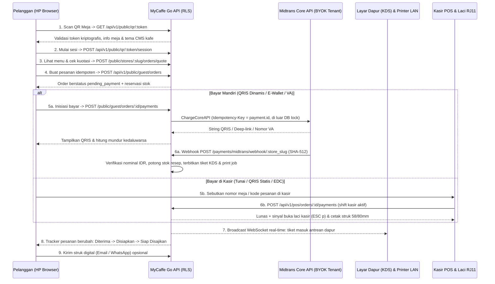

# Master Release Plan: MyCaffe QR Code Table Order v1.0 (End-to-End)

- **Produk**: MyCaffe QR Code Table Order, Cloud POS, KDS & Backoffice
- **Entitas Penyelenggara**: **AzureDevID** (NIB Terverifikasi, Dual-Brand *"MyCaffe by AzureDevID"*)
- **Target Rilis**: Demo Publik (`https://demo.abbdullaziz.online`) -> Produksi Klien Pertama (`https://pos.<client-domain>`)
- **Tanggal Dokumen**: 2026-11-07
- **Perspektif Penyusun**: Technical Writer, Project Manager, dan Business Owner

---

## 1. Executive Summary & Sasaran Rilis

Rilis **MyCaffe QR Code Table Order v1.0** dirancang agar kafe dan restoran dapat menerima pesanan langsung dari meja pelanggan hanya dengan memindai stiker QR unik per meja melalui browser ponsel (tanpa unduh aplikasi), menghitung harga/modifier/promo/PB1/service charge 100% di sisi server Go, memproses pembayaran langsung ke rekening kafe melalui **Midtrans Core API (QRIS Dinamis / GoPay / ShopeePay / VA)** atau **Bayar di Kasir (Tunai / QRIS Statis / EDC)**, meneruskan tiket otomatis ke layar dapur (**KDS**) dan printer thermal **ESC/POS**, serta menyajikan pembaruan status pesanan secara *real-time* kepada pelanggan.

Status kesiapan komponen utama:
- **Backend Core, Pricing, RLS, QR Session, KDS, Realtime WS, Print Queue, Inventory, SaaS Governance & BYOK (`000001` s.d. `000051`)**: *Implemented & Tested*.
- **Cloudflare DNS, Named Tunnel (`mycaffe-demo`), R2 CDN (`cdn.abbdullaziz.online`), Sentry Free Plan, Midtrans Sandbox Core API**: *Implemented & Tested*.
- **Client Monorepo Foundation (`myCaffe-client`: Design Tokens WCAG 2.2 AA, `id-ID`/`en-US` i18n, Visual Network Simulator, Android Kotlin ESC/POS Adapter, iOS Obj-C Bridge + Xcode CI)**: *Implemented & Tested*.
- **Midtrans Production Live Key Cutover**: *Blocked by Dependency* (menunggu persetujuan *Business Review* Midtrans; selama masa tunggu, demo menggunakan Sandbox dan operasional produksi awal dapat menggunakan QRIS Statis / Tunai / EDC atau kunci BYOK Midtrans milik klien yang sudah aktif).

---

## 2. Alur Bisnis & Siklus Hidup Transaksi (End-to-End Lifecycle)

### Pemisahan Negara Bagian (State Separation)
Sesuai prinsip rekayasa utama `AGENTS.md`, `payment_status` dan `order_status` dipisahkan secara ketat:
- **`payment_status` (`orders`)**: `unpaid` -> `pending` -> `partially_paid` -> `paid` (atau `failed` / `refunded` / `partially_refunded`).
- **`status` (`orders`)**: `pending_payment` (atau `open` untuk Open Tab) -> `queued` -> `preparing` -> `ready` -> `served` -> `completed` (atau `cancelled`).

---

## 3. Kontrak Input & Output (I/O Matrix)

| Tahap | Aktor | Input Utama | Validasi Server | Output Utama |
|-------|-------|-------------|-----------------|--------------|
| Onboarding Tenant | Calon Pemilik Kafe | Nama usaha, slug, jenis badan usaha, kontak, NIB/NPWP, paket, hash SHA-256 ToS & UU PDP | Validasi format slug, keberadaan paket, masking NIB/NPWP otomatis, idempotensi | Bukti pengajuan onboarding & status review |
| Setup BYOK Pembayaran | Pemilik Kafe | Merchant ID, Client Key, Server Key Midtrans, mode Sandbox/Prod | Pemeriksaan awalan kunci, uji autentikasi HTTP ke Core API (opsional), enkripsi AES-256-GCM AAD `store_id` | Status validasi `valid` + tampilan kunci tersamar (`SB-Mid-****qb6g`) |
| Pemindaian QR Meja | Pelanggan | Token QR acak kriptografis pada URL meja | Resolusi via `resolve_table_qr` (menolak meja arsip atau token lama yang sudah dirotasi) | Cookie/token sesi tamu + konfigurasi CMS & lokalisasi (`id-ID`/`en-US`) |
| Kuotasi & Pemesanan | Pelanggan / Kasir | Daftar `variant_id`, kuantitas, opsi modifier bersarang 1 level, catatan item, `idempotency_key` | Hitung ulang harga katalog server, diskon promo terbaik, biaya bungkus, service charge, PB1 integer Rupiah, cek stok | Snapshot permanen `order_items` & `order_item_options`, nomor urut harian, token pelacak |
| Pembayaran & Rekonsiliasi | Midtrans / Kasir | Payload webhook JSON bertanda tangan SHA-512 atau input tunai/referensi EDC kasir | `ConstantTimeCompare` SHA-512, pencocokan integer IDR tanpa koma sen non-nol, shift kasir terbuka untuk tunai | Perubahan status `paid`, jurnal kas, pengurangan stok bahan baku, tiket KDS, struk ESC/POS |

---

## 4. Matriks Edge Case, Risiko, dan Mitigasi Operasional

| No | Skenario Risiko / Edge Case | Dampak jika Gagal | Mekanisme Pengaman di MyCaffe |
|----|-----------------------------|-------------------|-------------------------------|
| 1 | **Akun Midtrans Production masih Business Review** | Charge QRIS produksi ditolak (`401`/`402`) saat hari pembukaan kafe | Variabel `PLATFORM_MIDTRANS_IS_PRODUCTION=false` di demo; tombol `fallback_static_qris_enabled` mengizinkan kafe langsung berjualan memakai QRIS Statis berbingkai cetak + Tunai + EDC sembari menunggu persetujuan Midtrans. |
| 2 | **Pelanggan menutup browser setelah scan bayar QRIS** | Pelanggan panik mengira pesanan hilang | Status lunas dipicu oleh webhook server-to-server Midtrans (bukan redirect browser); token pelacak publik (`GET /public/orders/track/:token`) memulihkan layar status kapan saja. |
| 3 | **Webhook settlement datang terlambat setelah stok habis** | Uang pelanggan sudah terpotong tetapi transaksi DB gagal commit | Menggunakan `SAVEPOINT payment_stock_commit`: catatan uang `paid` tetap disimpan secara sah, pengurangan stok yang minus dibatalkan parsial, dan sistem membunyikan peringatan `payment.late_settlement_stock_exhausted` ke kasir untuk refund/penggantian menu. |
| 4 | **Foto stiker QR meja disebarkan orang iseng di luar kafe** | Pesanan palsu membebani dapur | Mode meja mendukung *Pay-First* (pesanan tidak masuk KDS sebelum uang lunas), batas ukuran payload, dan pemilik kafe dapat menekan **Rotasi Token QR (`POST /pos/tables/:id/rotate-qr`)** kapan saja untuk menggugurkan QR lama seketika. |
| 5 | **Internet ISP kafe putus mendadak saat jam sibuk** | Antrean kasir macet total | Kasir tablet tetap menerima pembayaran Tunai/QRIS Statis menggunakan kredensial perangkat terdaftar (ADR-005), membuka laci RJ11 via LAN lokal `TCP:9100`, dan menyinkronkan antrean saat internet pulih. |
| 6 | **Router kafe restart dan mengubah IP printer dapur** | Tiket dapur tidak tercetak | Layar KDS tetap menampilkan pesanan; pemilik membuka menu **Self-Maintain Jaringan** untuk memperbarui IP printer atau menjalankan **Simulator Jaringan** tanpa menunggu teknisi luar. |
| 7 | **Kendala OTP portal PSE Komdigi saat pendaftaran** | Proses unggah Tanda Daftar PSE tertunda | Mengikuti alur SSO **OSS RBA -> PB-UMKU -> Pendaftaran PSE Lingkup Privat** sesuai panduan di brankas legal `PanduanSolusiOtpPseKomdigi.md`. |

---

## 5. Strategi Brand, Harga Langganan SaaS, dan Onboarding

### 5.1 Identitas Brand & Bahasa Desain
- **Brand Korporat & Penagihan**: **AzureDevID** (`#0A4DA2` Royal Azure, `#00AEEF` Electric Cyan, tipografi `Plus Jakarta Sans` + `JetBrains Mono` untuk nominal/kode).
- **Brand Produk F&B Default**: **MyCaffe** (*Espresso & Crema*: `#2C1A12` Espresso Roast, `#C68B59` Warm Crema, `#FAF6F0` Oat Milk Surface).
- **Standar Aksesibilitas & Bahasa**: Seluruh token warna lulus rasio kontras **WCAG 2.2 AA** (`>= 4.5:1` teks normal, teruji otomatis pada `verify-tokens.mjs`), mendukung mode kontras tinggi (`high_contrast_mode`), target sentuh minimal `44x44 px`, navigasi keyboard penuh, dan lokalisasi dwibahasa penuh **`id-ID` (utama)** serta **`en-US` (turis/ekspatriat)**.

### 5.2 Skema Paket Harga (0% Komisi Transaksi)

| Kode Paket | Nama Paket | Harga Bulanan | Harga Tahunan (Hemat 20%) | Batas Meja & Printer | Fitur Kunci |
|------------|------------|---------------|---------------------------|----------------------|-------------|
| `trial_14d` | Uji Coba Gratis 14 Hari | Rp 0 | Rp 0 | Maks. 15 meja, 1 printer | Kasir POS, QR Table Order (QRIS Statis/Tunai), KDS & TV Antrean |
| `starter_umkm` | Starter UMKM | Rp 149.000 | Rp 1.430.400 | Maks. 15 meja, 1 printer | POS Kasir, QR Menu Statis/Tunai, Shift Kasir, Laporan Harian |
| `pro_cafe` | Pro Cafe & Resto | Rp 299.000 | Rp 2.870.400 | Tanpa batas meja/printer | **BYOK Midtrans QRIS Dinamis (0% komisi)**, Open Tab & Split Bill, KDS, TV Antrean, Resep/HPP/PO, BYO Email/WA |
| `enterprise_whitelabel` | Enterprise White-Label | Rp 599.000 | Rp 5.750.400 | Tanpa batas meja/printer | Seluruh fitur Pro + **Custom Domain**, **Hapus Badge Powered by MyCaffe**, SLA Prioritas |

---

## 6. Panduan Singkat Operasional (Mini Manual Book / Guidebook)

### 6.1 Panduan Pemilik Kafe (Owner Onboarding dalam 15 Menit)
1. **Registrasi & Persetujuan Hukum**: Ajukan akun pada halaman onboarding, pilih paket (`trial_14d` atau `pro_cafe`), dan setujui dokumen ToS serta Kebijakan Privasi UU PDP.
2. **Konfigurasi Profil Gerai & Pajak**: Masuk ke Backoffice, atur persentase PB1 (mis. 10%), *service charge* (mis. 5%), pembulatan tunai, serta tampilan logo/warna di menu **CMS Storefront**.
3. **Unggah Menu & Resep**: Buat kategori, produk, varian harga, serta grup modifier (level gula, es, ukuran cup, ekstra topping) dan foto `.webp` ke CDN R2.
4. **Hubungkan Pembayaran (BYOK Midtrans)**: Masukkan *Merchant ID*, *Client Key*, dan *Server Key* Midtrans gerai Anda, aktifkan tombol uji koneksi, lalu salin URL Webhook khusus gerai Anda (`https://api.<domain>/api/v1/payments/midtrans/webhook/<store_slug>`) ke Dashboard Midtrans -> *Settings -> Configuration -> Payment Notification URL*.
5. **Daftarkan Perangkat Fisik & Cetak QR Meja**: Masukkan IP printer thermal dapur/kasir di menu **Self-Maintain Jaringan**, jalankan tombol **Simulasi Topologi**, lalu buat daftar nomor meja dan cetak stiker QR tiap meja.

### 6.2 Panduan Kasir & Barista (Operasional Harian)
1. **Buka Shift Kasir**: Masuk menggunakan email/kartu ID + PIN 6 digit, pilih laci kasir, dan catat modal uang kembalian awal (*Opening Float*).
2. **Pantau Pesanan Masuk**: Pesanan QR yang sudah dibayar otomatis muncul di layar KDS dan tercetak di printer stasiun bar/dapur. Untuk pesanan *Bayar di Kasir*, pilih nomor pesanan, terima uang tunai/EDC/QRIS Statis, maka laci uang otomatis terbuka.
3. ** Penanganan Kendala Cepat**:
   - Jika produk habis mendadak di tengah hari: tekan toggle **Habis Sementara (86)** pada menu katalog staf; menu otomatis terkunci di HP pelanggan dalam hitungan detik.
   - Jika salah input atau pembatalan: ajukan **Void / Refund**; untuk nominal di atas batas wewenang kasir, minta persetujuan PIN Owner.
4. **Tutup Shift (Z-Report)**: Hitung uang fisik di laci (*Blind Count*), simpan laporan penutupan shift, dan rekonsiliasi selisih kas.

### 6.3 Panduan Pelanggan (Tamu Meja)
1. Buka kamera ponsel atau pemindai QR standar dan arahkan ke stiker QR di atas meja.
2. Pilih bahasa (`ID` / `EN`) di pojok atas bila diperlukan, pilih makanan/minuman beserta kustomisasi (gula/es/topping), lalu periksa rincian pajak dan total akhir di keranjang.
3. Pilih **Bayar Instan (QRIS / E-Wallet)**, simpan/pindai kode QRIS pada aplikasi m-banking/e-wallet Anda, dan pantau status persiapan pesanan secara langsung di layar hingga diantar ke meja.

---

## 7. Topologi Deployment per Environment & Checklist Go-Live

| Environment | Infrastruktur | Database & Storage | Pembayaran & Notifikasi | Tujuan |
|-------------|---------------|--------------------|-------------------------|--------|
| **Development** | Laptop Windows 11 (`go run ./cmd/api` + `myCaffe-client`) | Docker `postgres:18-alpine` lokal + R2 `mycaffe-media` / lokal | Midtrans Sandbox + `EMAIL_DRIVER=log` / Gmail SMTP | Pengembangan harian, unit test, kompilasi Android SDK & `zig cc` Obj-C |
| **Demo / Staging** | Docker Compose (`docker-compose.demo.yml`) + Cloudflare Named Tunnel `mycaffe-demo` (`https://demo.abbdullaziz.online`) | Docker `postgres:18-alpine` terisolasi + R2 CDN `https://cdn.abbdullaziz.online` | Midtrans Sandbox Core API + Hostinger/Gmail SMTP + SMS-to-Email OTP | Demo langsung ke calon klien menggunakan HP/tablet nyata & uji webhook Midtrans Sandbox |
| **Production** | VPS Klien / Produksi (Hostinger KVM 2 Ubuntu 24.04 LTS, `docker-compose.prod.yml` via image GHCR bertanda digest) | PostgreSQL 18 internal subnet + backup terenkripsi GPG per jam ke R2 `mycaffe-backups` | Lane 1 Sandbox/Live (sesuai status review) + Lane 2 BYOK Midtrans Live per tenant + Hostinger SMTP SPF/DKIM/DMARC | Operasional komersial penuh dengan Zero In-Place Coding |

### Gate Persetujuan Akhir Sebelum Cutover Produksi Klien Pertama
1. Seluruh 3 workflow GitHub Actions (`build-and-test`, `docker-build`, `database-migration-test`) berstatus hijau pada cabang `staging` sebelum promosi ke `main`.
2. Kunci produksi `JWT_SECRET_KEY`, `CREDENTIAL_ENCRYPTION_KEY`, dan `PLATFORM_ADMIN_API_KEY` dibangkitkan dengan entropi kriptografis minimal 32 byte di luar repositori Git.
3. Drill pemulihan cadangan (`restore_from_r2.sh`) diuji minimal satu kali pada VPS target sebelum menerima transaksi uang riil.

