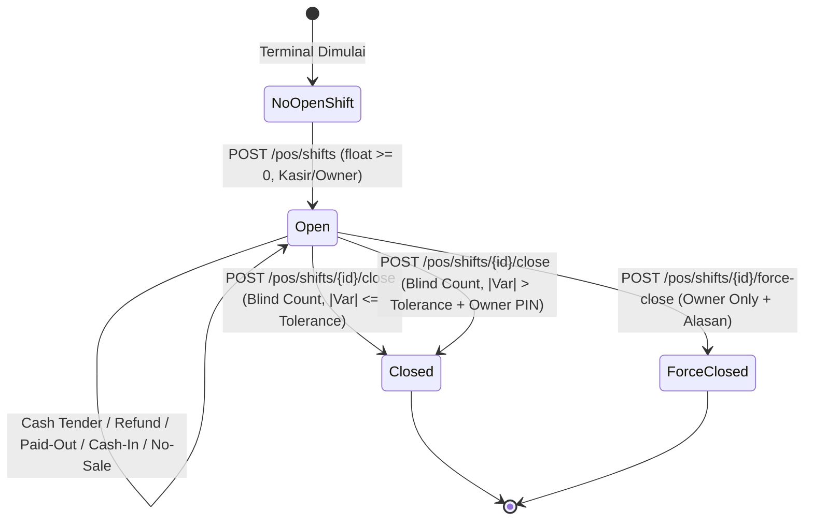

# Technical Design: Iteration 4b — Shift & Cash Drawer

Dokumen ini mendefinisikan arsitektur teknis, kontrak basis data, state machine, batas transaksi, serta matriks pengujian untuk **Iteration 4b (Shift & Cash Drawer)** pada MyCaffe Core POS.

Desain ini merealisasikan keputusan bisnis owner **P6, P7, C1, H1** (wawancara keenam) dan melanjutkan arsitektur katalog/modifier yang telah diselesaikan di Iteration 4a.

---

## 1. Business Alignment & Context

| ID | Keputusan | Konsekuensi Arsitektur |
|----|-----------|------------------------|
| **P6** | **1 Drawer per Terminal POS; 1 Open Shift per Drawer** | Relasi 1:1 antara terminal dan laci kas. Pergantian kasir (*handover*) dilakukan via siklus `close` -> `open`. Partial unique index memastikan tidak ada 2 shift yang terbuka bersamaan di satu laci. Mode `single_auto` didukung untuk kafe kecil (1 shift per hari kerja, modal awal 0). Owner dapat melakukan *force-close* pada shift yang ditinggalkan kasir. |
| **P7** | **Laci Otomatis Terbuka pada Transaksi Kas; Audit `no_sale`** | Respons transaksi kas (`sale`, `refund`, `paid_out`, `cash_in`, `no_sale`) menyertakan instruksi `open_drawer: true` untuk memicu kick RJ-11 printer ESC/POS. Aksi `no_sale` wajib memiliki alasan tekstual dan diaudit ketat pada X/Z Report. |
| **C1** | **Blind Cash Count pada Tutup Shift & Toleransi Selisih (Variance)** | Saat menutup shift, kasir memasukkan jumlah uang fisik yang dihitung di laci tanpa melihat nilai *expected cash* sistem (*blind count*). Jika selisih `|counted - expected| > cash_variance_tolerance` toko, penutupan wajib menyertakan alasan dan verifikasi PIN Owner. |
| **H1** | **Hardware Drawer Kick via ESC/POS** | Backend tidak terhubung langsung ke hardware fisik; backend menyediakan instruksi standar `open_drawer: true` pada payload JSON response kasir, yang diteruskan frontend ke printer via ESC/POS command `ESC p` (`\x1b\x70\x00\x19\xfa`). |

---

## 2. Database Contract (Migration 000010)

Migration: `db/migrations/000010_iteration_4b_shift_cash_drawer.up.sql`

```sql
-- 1. Cash Drawers Table (Physical / Terminal POS Drawer)
CREATE TABLE cash_drawers (
    id UUID PRIMARY KEY DEFAULT gen_random_uuid(),
    store_id UUID NOT NULL REFERENCES stores(id) ON DELETE CASCADE,
    name VARCHAR(50) NOT NULL,
    code VARCHAR(20) NOT NULL,
    is_active BOOLEAN NOT NULL DEFAULT true,
    created_at TIMESTAMPTZ NOT NULL DEFAULT NOW(),
    updated_at TIMESTAMPTZ NOT NULL DEFAULT NOW(),
    CONSTRAINT uq_cash_drawers_code UNIQUE (store_id, code)
);

CREATE INDEX idx_cash_drawers_store ON cash_drawers(store_id);

-- 2. Shifts Table
CREATE TABLE shifts (
    id UUID PRIMARY KEY DEFAULT gen_random_uuid(),
    store_id UUID NOT NULL REFERENCES stores(id) ON DELETE CASCADE,
    drawer_id UUID NOT NULL REFERENCES cash_drawers(id) ON DELETE RESTRICT,
    opened_by UUID NOT NULL REFERENCES staff_users(id) ON DELETE RESTRICT,
    opening_float BIGINT NOT NULL CHECK (opening_float >= 0),
    opened_at TIMESTAMPTZ NOT NULL DEFAULT NOW(),
    closed_by UUID REFERENCES staff_users(id) ON DELETE RESTRICT,
    closed_at TIMESTAMPTZ,
    status VARCHAR(20) NOT NULL DEFAULT 'open' CHECK (status IN ('open', 'closed', 'force_closed')),
    expected_cash BIGINT CHECK (expected_cash IS NULL OR expected_cash >= 0),
    counted_cash BIGINT CHECK (counted_cash IS NULL OR counted_cash >= 0),
    variance BIGINT, -- counted_cash - expected_cash (bisa negatif)
    variance_reason TEXT,
    owner_override_by UUID REFERENCES staff_users(id) ON DELETE RESTRICT,
    notes TEXT,
    created_at TIMESTAMPTZ NOT NULL DEFAULT NOW(),
    updated_at TIMESTAMPTZ NOT NULL DEFAULT NOW()
);

-- Partial Unique Index: Maksimal 1 shift berstatus 'open' per drawer per toko
CREATE UNIQUE INDEX idx_shifts_open_drawer ON shifts(store_id, drawer_id) WHERE status = 'open';
CREATE INDEX idx_shifts_store_opened ON shifts(store_id, opened_at DESC);

-- 3. Cash Movements Table (Append-Only Ledger)
CREATE TABLE cash_movements (
    id UUID PRIMARY KEY DEFAULT gen_random_uuid(),
    store_id UUID NOT NULL REFERENCES stores(id) ON DELETE CASCADE,
    shift_id UUID NOT NULL REFERENCES shifts(id) ON DELETE RESTRICT,
    movement_type VARCHAR(20) NOT NULL CHECK (
        movement_type IN ('opening_float', 'sale', 'refund', 'paid_out', 'cash_in', 'no_sale')
    ),
    amount BIGINT NOT NULL CHECK (amount >= 0), -- 0 untuk no_sale
    actor_id UUID NOT NULL REFERENCES staff_users(id) ON DELETE RESTRICT,
    reason TEXT,
    order_id UUID REFERENCES orders(id) ON DELETE SET NULL,
    payment_id UUID REFERENCES payments(id) ON DELETE SET NULL,
    created_at TIMESTAMPTZ NOT NULL DEFAULT NOW()
);

CREATE INDEX idx_cash_movements_shift ON cash_movements(store_id, shift_id, created_at ASC);
CREATE INDEX idx_cash_movements_payment ON cash_movements(payment_id) WHERE payment_id IS NOT NULL;

-- 4. Store Configuration Extensions
ALTER TABLE stores
    ADD COLUMN cash_variance_tolerance BIGINT NOT NULL DEFAULT 10000 CHECK (cash_variance_tolerance >= 0),
    ADD COLUMN shift_mode VARCHAR(20) NOT NULL DEFAULT 'standard' CHECK (shift_mode IN ('standard', 'single_auto'));

-- 5. Row-Level Security (RLS) Policies
ALTER TABLE cash_drawers ENABLE ROW LEVEL SECURITY;
ALTER TABLE shifts ENABLE ROW LEVEL SECURITY;
ALTER TABLE cash_movements ENABLE ROW LEVEL SECURITY;

CREATE POLICY tenant_isolation_cash_drawers ON cash_drawers
    FOR ALL TO mycaffe_app
    USING (store_id = NULLIF(current_setting('app.current_store_id', true), '')::UUID)
    WITH CHECK (store_id = NULLIF(current_setting('app.current_store_id', true), '')::UUID);

CREATE POLICY tenant_isolation_shifts ON shifts
    FOR ALL TO mycaffe_app
    USING (store_id = NULLIF(current_setting('app.current_store_id', true), '')::UUID)
    WITH CHECK (store_id = NULLIF(current_setting('app.current_store_id', true), '')::UUID);

CREATE POLICY tenant_isolation_cash_movements ON cash_movements
    FOR ALL TO mycaffe_app
    USING (store_id = NULLIF(current_setting('app.current_store_id', true), '')::UUID)
    WITH CHECK (store_id = NULLIF(current_setting('app.current_store_id', true), '')::UUID);

-- 6. Trigger: Immutability on Cash Movements
CREATE OR REPLACE FUNCTION prevent_cash_movement_tampering()
RETURNS TRIGGER AS $$
BEGIN
    RAISE EXCEPTION 'cash_movements table is append-only: updates and deletes are prohibited for financial integrity';
END;
$$ LANGUAGE plpgsql;

CREATE TRIGGER trg_prevent_cash_movement_tampering
BEFORE UPDATE OR DELETE ON cash_movements
FOR EACH ROW EXECUTE FUNCTION prevent_cash_movement_tampering();
```

---

## 3. Shift State Machine & Mathematical Model



### 3.1 Formula Expected Cash

Uang kas yang diharapkan di dalam laci dihitung secara deterministik dan hanya mencakup transaksi fisik tunai:

$$\text{Expected Cash} = \text{Opening Float} + \sum \text{Cash Sales} - \sum \text{Cash Refunds} - \sum \text{Paid Outs} + \sum \text{Cash Ins}$$

> [!IMPORTANT]
> **Pemisahan Non-Tunai:** Pembayaran QRIS (Midtrans/Statis) dan EDC tidak pernah dihitung ke dalam `expected_cash` laci kas fisik. Seluruh transaksi non-tunai diagregasikan secara terpisah pada X/Z Report untuk rekonsiliasi terminal perbankan dan settlement gateway.

### 3.2 Selisih Kas (*Variance*) & Blind Count

$$\text{Variance} = \text{Counted Cash} - \text{Expected Cash}$$

- **Variance > 0**: Kas lebih (*cash overage*).
- **Variance < 0**: Kas kurang (*cash shortage*).
- **Variance = 0**: Kas seimbang (*perfect balance*).

Jika $|\text{Variance}| > \text{store.cash\_variance\_tolerance}$:
- Kasir tidak dapat menutup shift secara mandiri.
- API mengembalikan error `422 VARIANCE_EXCEEDS_TOLERANCE` jika request tidak menyertakan `owner_pin` yang valid dan `variance_reason`.
- Bila verifikasi PIN owner lolos, `shifts.owner_override_by` diisi dengan ID owner tersebut, dan dicatat di `audit_logs`.

---

## 4. Operational Cash Movements & Atomic Transactions

Semua mutasi kas dicatat dalam tabel `cash_movements` di dalam transaksi database yang sama (`database.WithTenantTx`):

| Mutasi | Sifat | Pengaruh Kas | Kondisi & Validasi |
|--------|-------|--------------|-------------------|
| `opening_float` | Otomatis | $+ \text{amount}$ | Dibuat saat shift dibuka. Modal awal kas di laci kas. |
| `sale` | Otomatis | $+ \text{amount}$ | Dibuat saat POS menerima cash tender (`POST /pos/orders/{id}/payments` method `cash`). Memeriksa shift aktif; jika tidak ada, gagal `409 NO_OPEN_SHIFT`. Mengembalikan `open_drawer: true`. |
| `refund` | Otomatis | $- \text{amount}$ | Dibuat saat cash refund diproses. Memeriksa shift aktif & $\text{amount} \le \text{expected\_cash}$. Mengembalikan `open_drawer: true`. |
| `paid_out` | Manual | $- \text{amount}$ | Kasir/owner mengambil kas untuk pengeluaran operasional (e.g. es batu, gas, bumbu darurat). Wajib ada `reason` tertulis. $\text{amount} \le \text{expected\_cash}$. Mengembalikan `open_drawer: true`. |
| `cash_in` | Manual | $+ \text{amount}$ | Tambahan modal kas masuk di pertengahan shift. Wajib ada `reason`. Mengembalikan `open_drawer: true`. |
| `no_sale` | Manual | $0$ | Buka laci kas tanpa mutasi finansial (e.g. tukar receh). Wajib ada `reason`. Mengembalikan `open_drawer: true`. Dicatat dan diaudit khusus pada X/Z report untuk mencegah fraud. |

---

## 5. X Report vs. Z Report Specifications

### 5.1 X Report (`GET /pos/shifts/{id}/x-report`)
- **Tujuan**: Laporan bacaan tengah shift (*mid-shift audit / flash report*).
- **Karakteristik**:
  - Dapat diakses berkali-kali saat shift masih berstatus `open`.
  - Tidak mengubah status shift dan tidak membekukan angka.
  - Memperlihatkan performa shift berjalan: ringkasan penjualan per metode bayar, total kas masuk/keluar, dan indikasi `expected_cash` saat ini.

### 5.2 Z Report (`GET /pos/shifts/{id}/z-report`)
- **Tujuan**: Laporan pertanggungjawaban final (*end-of-shift reconciliation*).
- **Karakteristik**:
  - Dihasilkan saat status shift `closed` atau `force_closed`.
  - Berisi snapshot angka final yang tidak dapat diubah lagi:
    - Identitas laci, kasir pembuka, kasir penutup, waktu buka, waktu tutup.
    - Modal awal (`opening_float`).
    - Rincian total penjualan per metode pembayaran (`cash`, `qris`, `edc`, `midtrans`).
    - Rincian mutasi kas (`sales`, `refunds`, `paid_outs`, `cash_ins`).
    - Total transaksi, jumlah void, jumlah refund, jumlah `no_sale`.
    - Total diskon yang diberikan.
    - Nilai `counted_cash`, `expected_cash`, dan `variance`.
    - Catatan selisih kas dan identitas owner yang memberikan otorisasi override jika ada.

---

## 6. REST API Endpoints Specification

Semua endpoint shift berada di bawah prefix `/pos/shifts` dan `/pos/drawers`.

### 6.1 Laci Kas (`/pos/drawers`)
- `GET /pos/drawers`: Menampilkan daftar laci kas aktif di toko. Izin: `OrderPOSCreate` atau `ShiftManage`.
- `POST /pos/drawers`: Menambahkan laci kas baru (terminal baru). Izin: `StoreSettingsManage` (Owner only).

### 6.2 Siklus Shift (`/pos/shifts`)
- `GET /pos/shifts/current?drawer_id={uuid}`: Mengambil shift yang sedang aktif di laci kas tertentu. Izin: `OrderPOSCreate`.
- `POST /pos/shifts`: Membuka shift baru (`opening_float`, `drawer_id`, `notes`). Izin: `ShiftManage` (Kasir/Owner).
- `POST /pos/shifts/{id}/close`: Menutup shift dengan blind count (`counted_cash`, `notes`, opsional `variance_reason`, `owner_pin`). Izin: `ShiftClose` (Kasir/Owner).
- `POST /pos/shifts/{id}/force-close`: Force-close shift oleh owner (`reason`, `counted_cash`, `notes`). Izin: `ShiftForceClose` (Owner only).

### 6.3 Mutasi Kas Manual (`/pos/shifts/{id}/cash-movements`)
- `POST /pos/shifts/{id}/cash-movements`:
  - Body: `{ "movement_type": "paid_out" | "cash_in" | "no_sale", "amount": 25000, "reason": "Beli es batu 2 kantong" }`
  - Izin: `CashMovementCreate`.
  - Respons: `{ "movement": {...}, "open_drawer": true }`.

### 6.4 Laporan X / Z
- `GET /pos/shifts/{id}/x-report`: Menghasilkan X Report untuk shift terbuka. Izin: `ShiftManage`.
- `GET /pos/shifts/{id}/z-report`: Menghasilkan Z Report untuk shift tertutup. Izin: `ShiftManage`.

---

## 7. RBAC & Security Matrix

| Endpoint / Operasi | Kasir (`cashier`) | Barista (`barista`) | Kitchen (`kitchen`) | Pemilik (`owner`) |
|--------------------|-------------------|---------------------|---------------------|-------------------|
| Buka Shift (`POST /pos/shifts`) | Ya | Tidak (403) | Tidak (403) | Ya |
| Cash Tender di POS | Ya (bila shift open) | Tidak (403) | Tidak (403) | Ya |
| Catat Mutasi Kas (`paid_out`/`cash_in`/`no_sale`) | Ya | Tidak (403) | Tidak (403) | Ya |
| Baca X Report | Ya | Tidak (403) | Tidak (403) | Ya |
| Tutup Shift (Blind Count $\le$ Toleransi) | Ya | Tidak (403) | Tidak (403) | Ya |
| Tutup Shift (Selisih $>$ Toleransi) | Memerlukan PIN Owner | Tidak (403) | Tidak (403) | Ya (dengan alasan) |
| Force-Close Shift | Tidak (403) | Tidak (403) | Tidak (403) | Ya |
| Buat / Hapus Laci Kas (`drawers`) | Tidak (403) | Tidak (403) | Tidak (403) | Ya |

---

## 8. File-by-File Implementation Plan

| File | Komponen | Tanggung Jawab |
|------|----------|----------------|
| `db/migrations/000010_iteration_4b_shift_cash_drawer.up.sql` | Migration Up | Tabel `cash_drawers`, `shifts`, `cash_movements`, RLS policies, trigger anti-tampering, kolom toleransi di `stores`. |
| `db/migrations/000010_iteration_4b_shift_cash_drawer.down.sql` | Migration Down | Teardown bersih dan idempotent rollback. |
| `internal/domain/shift.go` | Domain Models | Struct `CashDrawer`, `Shift`, `CashMovement`, `XReport`, `ZReport`, enum status & tipe mutasi. |
| `internal/pkg/rbac/roles.go` | Permission Matrix | Definisi izin: `ShiftManage`, `ShiftClose`, `ShiftForceClose`, `CashMovementCreate`. |
| `internal/repository/postgres/shift_repository.go` | Data Access Layer | Query transactional `shifts` dan `cash_movements` di bawah RLS, aggregate sum cash sales/refunds. |
| `internal/service/shift_service.go` | Business Logic | Validasi blind count, toleransi selisih, kalkulasi expected cash, verifikasi PIN owner, pembuatan laporan X/Z. |
| `internal/service/payment_service.go` | Payment Integration | Injeksi pencatatan `cash_movements` saat cash tender berhasil, penolakan 409 bila laci belum memiliki open shift. |
| `internal/handler/shift_handler.go` | HTTP Transport | Handlers untuk siklus shift, cash movements, X/Z reports, dan flag `open_drawer`. |
| `internal/handler/shift_integration_test.go` | Integration Tests | Test komprehensif lifecycle shift, blind count, PIN override, cash movements, dan laporan Z. |
| `docs/api/openapi.yaml` | OpenAPI Contract | Dokumentasi schema request/response `/pos/drawers` dan `/pos/shifts`. |

---

## 9. Verification & Failure Scenarios Matrix

| Skenario | Expected Behavior |
|----------|-------------------|
| **Cash tender tanpa open shift** | HTTP `409 Conflict` dengan kode `NO_OPEN_SHIFT`. Order tetap dalam status unpaid, tidak ada uang yang dicatat. |
| **Dua kasir membuka drawer yang sama bersamaan** | Transaksi kedua gagal karena partial unique constraint `idx_shifts_open_drawer` (`409 CONFLICT`). |
| **Kasir mencoba menutup shift dengan selisih Rp 50.000 (toleransi Rp 10.000) tanpa PIN owner** | HTTP `422 Unprocessable Entity` dengan kode `VARIANCE_EXCEEDS_TOLERANCE`. Shift tetap terbuka. |
| **Kasir memasukkan PIN owner yang salah saat variance besar** | HTTP `401 Unauthorized` dengan kode `INVALID_OWNER_PIN`. Kegagalan PIN dicatat di audit log. |
| **Cash refund melebihi expected cash di laci** | Ditolak dengan HTTP `422 INSUFFICIENT_DRAWER_CASH`. Kasir tidak dapat mengeluarkan kas melebihi isi fisik laci. |
| **Aksi `no_sale` tanpa alasan (reason kosong)** | HTTP `422 Validation Error` field `reason: wajib diisi`. |
| **Upaya update atau delete pada `cash_movements`** | Trigger `trg_prevent_cash_movement_tampering` membangkitkan PostgreSQL exception, transaksi rollback. |
| **Cross-tenant access shift** | RLS memblokir akses ke drawer/shift toko lain dengan `404 NOT_FOUND`. |
