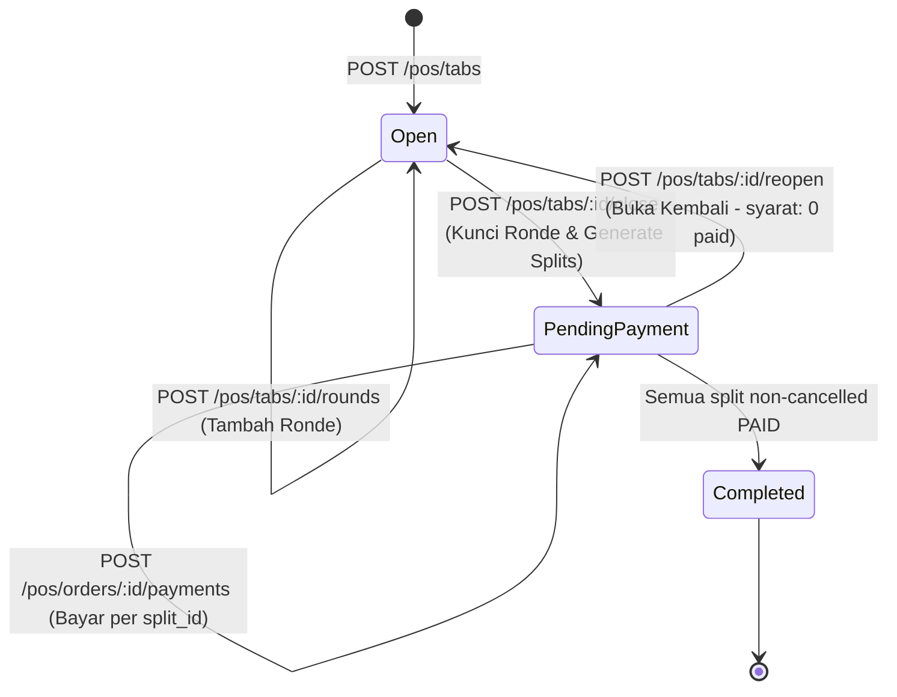

# Technical Execution Plan: Iteration 4c-2 (Split Bill & Tab Settlement Lifecycle)

- **Target Branch**: `feature/iteration-4c2-split-bill`
- **Scope**: Split Bill Engine (Equal Split $N$, By Item), Tab Close & Reopen Lifecycle, Payment Reuse with `split_id`, Per-Split Concurrency Protection, Shift Attribution via `payments.shift_id`, dan Shift X/Z Reconciliation Warning.
- **Prerequisite**: PR #20 merged to `staging`, Release `v0.4.0` tagged on `main`.

---

## 1. Business & Technical Architecture (P10–P14)

### A. Dua Strategi Split Bill Terverifikasi (P11)
1. **Equal Split (Bagi Rata $N$ Orang)**:
   - Nilai $N$ diwajibkan antara 2 hingga 20 orang.
   - Total tagihan dibagi menjadi $N$ bagian:
     $$\text{base\_subtotal} = \lfloor \text{subtotal} / N \rfloor, \quad \text{base\_tax} = \lfloor \text{tax} / N \rfloor, \quad \text{base\_service} = \lfloor \text{service} / N \rfloor$$
     $$\text{base\_total} = \text{base\_subtotal} + \text{base\_service} + \text{base\_tax}$$
   - **Deterministic Remainder Allocation**: Selisih sisa pembagian bulat integer Rupiah ditambahkan secara eksklusif ke **Split #1**:
     $$\text{split}_1.\text{total} = \text{base\_total} + (\text{order.total\_amount} - (\text{base\_total} \times N))$$
   - Setiap split wajib menghasilkan nominal `total_amount > 0`.
   - Contoh: Tagihan Rp100.000 dibagi 3 orang:
     - Split #1: Rp33.334
     - Split #2: Rp33.333
     - Split #3: Rp33.333
     - Total: Rp100.000 (Presisi integer Rp 100%).

2. **Split by Item (Berdasarkan Pesanan Tiap Tamu)**:
   - Kasir memilih subset item dan kuantitas per split.
   - **Aturan Alokasi Unit Utuh**: Alokasi berbasis kuantitas bulat (`quantity INT >= 1`). Satu unit menu tidak boleh dipecah pecahan desimal.
   - **Validasi Alokasi Lengkap**: Seluruh kuantitas dari semua item pada pesanan (`order_items`) WAJIB teralokasi tepat sekali:
     $$\sum_{s=1}^{M} \text{allocated\_qty}(item_i, s) = item_i.\text{quantity}$$
     Jika ada item yang kurang teralokasi atau berlebih $\to$ kembalikan `422 UNPROCESSABLE_ENTITY` dengan detail error per item.
   - **Proporsi Pajak & Service Charge**:
     - Service charge (5%) dan Pajak (PB1 10%) dari pesanan dialokasikan secara proporsional terhadap subtotal split:
       $$\text{split}_k.\text{service} = \lfloor \text{order.service\_charge} \times \frac{\text{split}_k.\text{subtotal}}{\text{order.subtotal}} \rfloor$$
       $$\text{split}_k.\text{tax} = \lfloor \text{order.tax\_amount} \times \frac{\text{split}_k.\text{subtotal}}{\text{order.subtotal}} \rfloor$$
     - Selisih sisa pembulatan Rupiah dialokasikan secara deterministik ke **Split Terakhir** (*last split*).
   - Validasi ketat: $\sum \text{split.total\_amount} = \text{orders.total\_amount}$.

3. **Status Custom Amount Split**:
   - Dikeluarkan dari scope Iteration 4c-2 sesuai keputusan bisnis P3. Dicatat sebagai backlog kandidat masa depan setelah operasional dasar stabil.

---

## 2. Tab Lifecycle & State Machine (P10)



1. **`POST /pos/tabs/:id/close` (Penguncian Tagihan)**:
   - Mengubah status pesanan dari `open` menjadi `pending_payment` (bukan `closed`, karena `closed` tidak ada di database constraint `chk_orders_status`).
   - Menerima opsi strategi split pada request body (`strategy: "equal" | "by_item"`).
   - **Tab Single-Payer**: Jika tidak ada parameter split (atau tab langsung ditutup tanpa split), otomatis membuat 1 entri split bertipe `full` senilai total pesanan.
   - Ronde baru setelah tab berstatus `pending_payment` ditolak keras dengan `409 TAB_CLOSED`.

2. **`POST /pos/tabs/:id/reopen` (Pembatalan Split & Buka Kembali)**:
   - Mengembalikan status pesanan dari `pending_payment` ke `open`.
   - Menandai semua split yang ada menjadi `status = 'cancelled'` (baris data tetap disimpan untuk jejak audit).
   - **Guardrail Keamanan**: Reopen HANYA diizinkan jika **belum ada split yang berstatus `paid`** DAN **tidak ada transaksi pembayaran yang masih `pending`**. Jika sudah ada pembayaran $\to$ tolak `409 SPLIT_ALREADY_PAID`.

3. **Transisi Pelunasan Pesanan (`completed`)**:
   - Setiap pembayaran melunasi split tertentu.
   - Pesanan utama (`orders`) HANYA bertransisi ke `payment_status = 'paid'` dan `status = 'completed'` saat SEMUA split yang berstatus non-cancelled telah lunas (`status = 'paid'`).

---

## 3. Database Schema Migration `000012` (P13)

Tabel `payment_splits` dan `payment_split_items` sudah ada sejak migrasi `000001`. Migrasi `000012` menambahkan atribusi shift pada pembayaran dan indeks performa:

```sql
-- Migration: 20261101000012_split_bill_and_payment_shift.up.sql

-- 1. Tambah kolom shift_id pada payments untuk atribusi shift yang menerima pembayaran
ALTER TABLE payments
    ADD COLUMN IF NOT EXISTS shift_id UUID NULL REFERENCES shifts(id) ON DELETE RESTRICT;

CREATE INDEX IF NOT EXISTS idx_payments_store_shift ON payments(store_id, shift_id);
CREATE INDEX IF NOT EXISTS idx_payments_store_split ON payments(store_id, split_id);
CREATE INDEX IF NOT EXISTS idx_payment_splits_order_status ON payment_splits(store_id, order_id, status);
```

---

## 4. Pembayaran & Konkurensi Split (P12)

1. **Gunakan Kembali Rute Pembayaran POS**:
   - Dilarang membuat endpoint `/splits/:id/pay` baru.
   - Perluas request payload `POST /api/v1/pos/orders/:id/payments`:
     ```json
     {
       "payment_method": "cash", // "cash" | "midtrans_qris" | "edc"
       "split_id": "00000000-0000-0000-0000-000000000000",
       "amount": 33334,
       "cash_tendered_amount": 50000 // jika tunai
     }
     ```
   - **Validasi Billing Mode**:
     - Jika `billing_mode == 'open_tab'`: `split_id` adalah **WAJIB**. Jika kosong $\to$ `400 BAD_REQUEST`.
     - Jika `billing_mode == 'pay_first'`: `split_id` **DITOLAK** $\to$ `400 BAD_REQUEST`.

2. **Aturan Pergerakan Kas**:
   - Transaksi tunai mencatat mutasi laci kas dengan tipe `sale` yang sudah ada (tidak ada tipe `SHIFT_TENDER`).

3. **Proteksi Konkurensi per Split (Anti-Double Charge)**:
   - Pada `PaymentService.TenderDirect` dan `PaymentService.InitiateMidtransCharge`:
     - Lakukan penguncian baris split: `SELECT * FROM payment_splits WHERE id = $1 AND store_id = $2 FOR UPDATE`.
     - Validasi: Status split wajib `unpaid`. Jika sudah `paid` $\to$ `409 SPLIT_ALREADY_PAID`.
     - Validasi: Cek apakah ada pembayaran lain untuk split ini yang berstatus `pending` (misal QRIS sedang menunggu scan). Jika ada $\to$ tolak dengan `409 SPLIT_PAYMENT_PENDING` ("Split has a pending payment. Cancel or wait for expiry before retrying").
   - Webhook Midtrans:
     - Melunasi tepat satu split yang terikat (`payments.split_id`).
     - Validasi `gross_amount` Midtrans wajib sama persis dengan `split.total_amount`.

---

## 5. Shift Decoupling & Rekonsiliasi X/Z Report (P13, P14)

1. **Shift Decoupling**:
   - Tab yang dibuka pada shift A dapat dibayar pada shift B.
   - Field `payments.shift_id` diisi dengan ID shift kasir yang aktif saat mengeksekusi pembayaran (termasuk non-tunai jika kasir sedang membuka shift).
   - Laporan X/Z menghitung omzet kasir berdasarkan `payments.shift_id = current_shift_id`, sehingga kasir shift B mendapatkan kredit penjualan yang tepat atas tab yang dilunasi pada jam kerjanya.

2. **Peringatan Open Tab pada Penutupan Shift**:
   - Endpoint `POST /pos/shifts/current/close` TIDAK diblokir oleh open tabs.
   - Respons X/Z Report dan ringkasan penutupan shift memuat objek audit:
     ```json
     {
       "unsettled_open_tabs_count": 2,
       "unsettled_open_tabs_total_amount": 185000,
       "unsettled_open_tabs": [
         { "order_number": "ORD-20261101-0005", "label": "Meja 4", "status": "open", "total_amount": 120000 },
         { "order_number": "ORD-20261101-0008", "label": "Meja 7", "status": "pending_payment", "total_amount": 65000 }
       ]
     }
     ```
   - Tab yang melewati pergantian hari bisnis (`business_date < current_business_date`) ditandai dengan flag `is_overdue_business_date: true`.

---

## 6. Implementation Quality Gates (Integration Tests)

Seluruh skenario berikut wajib diuji secara otomatis pada container PostgreSQL 18 lokal via `./scripts/dev.ps1 test-int` (`-race -count=1`):

1. **Test Close & Reopen Lifecycle**:
   - Tab `open` $\to$ `/close` menjadi `pending_payment`.
   - Submit ronde baru saat `pending_payment` $\to$ `409 TAB_CLOSED`.
   - `/reopen` sebelum ada pembayaran $\to$ status kembali ke `open`, splits menjadi `cancelled`.
   - `/close` kembali $\to$ splits baru terbuat.
2. **Test Tab Single-Payer**:
   - `/close` tanpa request split $\to$ otomatis 1 split mode `full` bernilai 100% total order.
   - Bayar via `POST /pos/orders/:id/payments` dengan `split_id` $\to$ split `paid`, order `completed`.
3. **Test Equal Split N (Deterministic Remainder)**:
   - Tagihan ganjil (misal Rp100.000 bagi 3): Split 1 = Rp33.334, Split 2 = Rp33.333, Split 3 = Rp33.333.
   - Jumlah total split = Rp100.000 persis.
4. **Test Split by Item & Tax Proportionality**:
   - Order dengan 3 menu + voucher diskon + service charge (5%) + pajak (10%).
   - Alokasi item valid: kuantitas utuh tepat sama dengan kuantitas pesanan.
   - Verifikasi $\sum \text{split.total\_amount} == \text{orders.total\_amount}$ secara mutlak.
   - Alokasi item kurang atau berlebih $\to$ ditolak `422 UNPROCESSABLE_ENTITY`.
5. **Test Konkurensi & Anti Double-Charge Split**:
   - Split 1 diinisiasi via QRIS Midtrans (`status = 'pending'`).
   - Kasir mencoba bayar tunai untuk Split 1 $\to$ ditolak `409 SPLIT_PAYMENT_PENDING`.
   - QRIS kedaluwarsa/dibatalkan $\to$ bayar tunai berhasil.
   - Dua request pembayaran paralel pada split yang sama $\to$ satu berhasil, satu ditolak lock `409`.
6. **Test Lintas Shift & X/Z Attribution**:
   - Tab dibuka oleh kasir Shift A (`orders.shift_id = Shift A`).
   - Tab dilunasi oleh kasir Shift B (`payments.shift_id = Shift B`).
   - X-Report Shift A: penjualan Rp0 dari tab tersebut.
   - X-Report Shift B: penjualan bertambah sesuai nominal yang dibayar pada Shift B.
7. **Test Unsettled Open Tabs pada Close Shift**:
   - Ada 1 tab `open` dan 1 tab `pending_payment`.
   - Kasir melakukan `POST /pos/shifts/current/close` $\to$ sukses `200 OK`, laporan penutupan shift memuat `unsettled_open_tabs_count: 2`.
