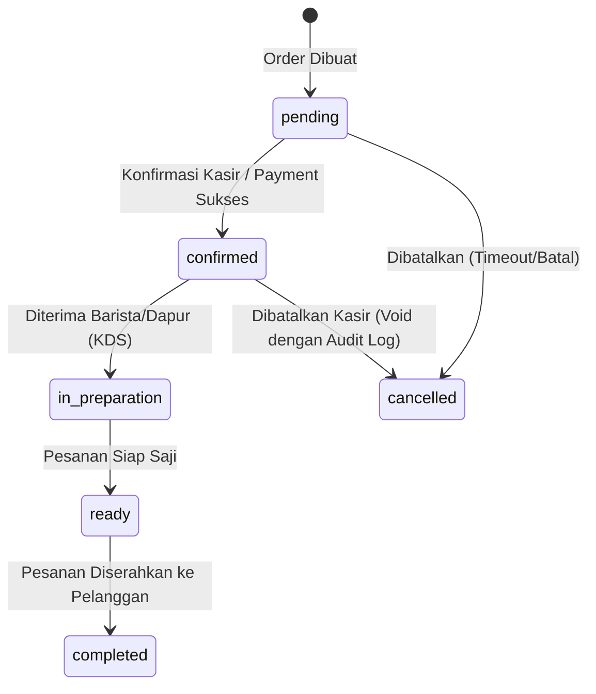
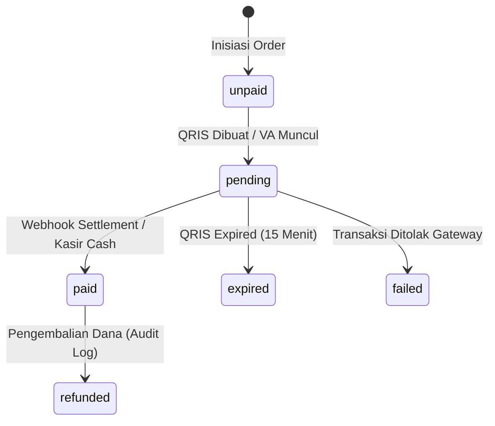

# Phase 01: Database & Transactional Architecture Contract
**Kafe Senja Vibe — Multi-Tenant POS, Kitchen Display System (KDS), and Ordering Platform**

---

## 1. Executive Summary & Design Scope

Dokumen ini mendefinisikan arsitektur data dan kontrak transaksional untuk **Kafe Senja Vibe** pada fase fondasi (Phase 01). Tujuannya adalah menjamin:
- **Tenant Isolation**: Isolasi data per store/outlet secara fisik dan logis tanpa celah kebocoran lintas tenant (*cross-tenant leakage*).
- **Payment & Financial Integrity**: Perhitungan uang tanpa pembulatan mengambang (menggunakan integer Rupiah / `BIGINT` dan Basis Points / BPS untuk rasio persentase).
- **Transactional Atomicity & Resiliency**: State machine terpisah untuk pesanan dan pembayaran, atomic queue counter harian tanpa race-condition, dan Outbox Pattern untuk pengiriman event realtime/KDS.
- **Go Domain Model Alignment**: Pemetaan presisi antara kolom SQL yang nullable dengan Go types (`*string`, `*time.Time`, `sql.Null*`).

---

## 2. Multi-Tenant Isolation & Row-Level Security (RLS) Strategy

### 2.1 Defense-in-Depth Model
Kafe Senja Vibe menerapkan arsitektur isolasi berlapis ganda:
1. **Application-Layer Scoping (Mandatory)**: Setiap query dan mutasi dari backend Go wajib menyertakan filter klausa `WHERE store_id = $1` yang diekstraksi secara ketat dari authenticated context (`*gin.Context` via JWT claim `store_id`). Nilai `store_id` dari payload atau query parameter client tidak pernah dipercaya sebagai otorisasi.
2. **Database Engine RLS Enforcement**: Row-Level Security diaktifkan pada semua tabel operasional untuk mencegah kebocoran data jika terjadi celah SQL injection atau koneksi langsung via Supabase API (PostgREST / Supabase JS).

### 2.2 RLS Context Setting & Policy Design
Untuk koneksi pool backend (Go `pgxpool`), backend menyetel session variable lokal per transaksi:
```sql
-- Dijalankan pada awal transaksi database
SET LOCAL app.current_store_id = '11111111-1111-4111-8111-111111111111';
```

RLS Helper Function:
```sql
CREATE OR REPLACE FUNCTION current_store_id() RETURNS UUID AS $$
    SELECT NULLIF(current_setting('app.current_store_id', true), '')::UUID;
$$ LANGUAGE sql STABLE;
```

Contoh Policy pada Tabel `orders`:
```sql
ALTER TABLE orders ENABLE ROW LEVEL SECURITY;

CREATE POLICY store_isolation_orders ON orders
    FOR ALL
    USING (store_id = current_store_id())
    WITH CHECK (store_id = current_store_id());
```

---

## 3. Store Lifecycle & Soft Delete Contract

### 3.1 Status & Lifecycle State
Store/Tenant memiliki status operasional:
- `is_active` (`BOOLEAN DEFAULT TRUE`): Menandai apakah store dapat menerima pesanan baru.
- `deleted_at` (`TIMESTAMPTZ NULL`): Soft-delete timestamp.

### 3.2 Implikasi Soft Delete pada Child Tables
Jika store dihapus secara soft-delete (`deleted_at IS NOT NULL`):
1. Toko tidak dapat lagi membuat order atau menerima pembayaran baru.
2. Historical data (orders, payments, audit_logs) **TETAP UTUH** dan tidak di-cascade delete demi kepatuhan audit finansial dan pajak (PB1/UU Harmonisasi Peraturan Perpajakan).
3. Query operasional wajib menggunakan view atau filter aktif:
   ```sql
   SELECT * FROM stores WHERE deleted_at IS NULL AND is_active = TRUE;
   ```

---

## 4. Financial Modeling: Integer Rupiah & Basis Points (BPS)

### 4.1 Zero Floating-Point Rule
Untuk mencegah kesalahan akumulasi desimal IEEE 754:
- Semua nominal mata uang disimpan dalam **integer Rupiah** (`BIGINT` di PostgreSQL / `int64` di Go).
- Semua tarif persentase (Pajak PB1, Service Charge, MDR QRIS) disimpan dalam **Basis Points (BPS)**:
  $$1\% = 100\text{ bps}$$
  $$10\% = 1000\text{ bps}$$
  $$0.7\% = 70\text{ bps}$$

### 4.2 Formula Kalkulasi Finansial Server-Side
Perhitungan dilakukan secara eksklusif di server Go menggunakan integer arithmetic dengan pembulatan standard (Banker's rounding atau integer round-half-up):
$$\text{Tax Amount} = \left\lfloor \frac{\text{Taxable Amount} \times \text{tax\_bps} + 5000}{10000} \right\rfloor$$
$$\text{Service Amount} = \left\lfloor \frac{\text{Subtotal} \times \text{service\_bps} + 5000}{10000} \right\rfloor$$
$$\text{Gross Total} = \text{Subtotal} - \text{Discount} + \text{Service Amount} + \text{Tax Amount}$$

---

## 5. State Machine: Order Status vs. Payment Status

Status pesanan dan pembayaran dimodelkan secara terpisah agar mendukung berbagai skenario kafe (Pay-First vs. Pay-Later / Open Tab):

### 5.1 Order State Machine (`order_status`)


### 5.2 Payment State Machine (`payment_status`)


### 5.3 Valid Transitions Matrix
| Current State | Valid Next States | Trigger Event |
| :--- | :--- | :--- |
| `unpaid` | `pending`, `paid`, `cancelled` | Generate Dynamic QRIS, Direct Cash Pay, Cancel Order |
| `pending` | `paid`, `expired`, `failed` | Midtrans Webhook (`settlement`, `expire`, `deny`) |
| `paid` | `refunded` | Manager Refund Action with Reason |
| `confirmed` | `in_preparation`, `cancelled` | KDS Accept, Cashier Void |

---

## 6. Atomic Daily Queue Counter

### 6.1 Permasalahan Race Condition
Penggunaan `SELECT COUNT(*) + 1` atau `MAX(queue_number) + 1` rentan terhadap collision jika terjadi pemesanan simultan saat jam sibuk (*rush hour*).

### 6.2 Solusi Desain: Tabel Sequence Harian Per Toko
```sql
CREATE TABLE store_daily_sequences (
    store_id UUID NOT NULL REFERENCES stores(id) ON DELETE CASCADE,
    business_date DATE NOT NULL,
    last_seq INT NOT NULL DEFAULT 0,
    created_at TIMESTAMPTZ NOT NULL DEFAULT NOW(),
    updated_at TIMESTAMPTZ NOT NULL DEFAULT NOW(),
    PRIMARY KEY (store_id, business_date)
);
```

### 6.3 Query Atomic Increment
```sql
INSERT INTO store_daily_sequences (store_id, business_date, last_seq, updated_at)
VALUES ($1, CURRENT_DATE, 1, NOW())
ON CONFLICT (store_id, business_date)
DO UPDATE SET 
    last_seq = store_daily_sequences.last_seq + 1,
    updated_at = NOW()
RETURNING last_seq;
```
Query di atas mengunci baris (*row lock*) untuk toko dan tanggal tersebut secara mikro-detik, menjamin nomor antrean (`A01`, `A02`, dst.) selalu berurutan tanpa jeda atau nomor ganda.

---

## 7. Event Reliability: Transactional Outbox Pattern

### 7.1 Mengapa Outbox Pattern Diperlukan?
Dual-write problem terjadi jika database order berhasil di-commit, namun server crash atau koneksi WebSocket/KDS terputus sebelum event sempat dikirim.

### 7.2 Outbox Schema
```sql
CREATE TABLE outbox_events (
    id UUID PRIMARY KEY DEFAULT gen_random_uuid(),
    store_id UUID NOT NULL REFERENCES stores(id) ON DELETE CASCADE,
    event_type VARCHAR(64) NOT NULL, -- 'order.created', 'order.paid', 'kds.ticket_ready'
    aggregate_type VARCHAR(32) NOT NULL, -- 'order', 'payment'
    aggregate_id VARCHAR(64) NOT NULL,
    payload JSONB NOT NULL,
    created_at TIMESTAMPTZ NOT NULL DEFAULT NOW(),
    processed_at TIMESTAMPTZ NULL,
    retry_count INT NOT NULL DEFAULT 0,
    last_error TEXT NULL
);

CREATE INDEX idx_outbox_unprocessed ON outbox_events (created_at) WHERE processed_at IS NULL;
```

### 7.3 Delivery Flow
1. Endpoint order/webhook menulis ke tabel operasional (`orders`, `payments`) dan `outbox_events` dalam **satu transaksi database ACID (`BEGIN ... COMMIT`)**.
2. Background worker Go membaca event yang belum diproses (`processed_at IS NULL`), meneruskannya ke WebSocket Hub (`internal/realtime`), dan menandai `processed_at = NOW()`.

---

## 8. Go Domain Model & Nullable SQL Type Alignment

Tipe data Go harus mencerminkan kontrak nullable database secara presisi:

```go
package domain

import (
	"database/sql"
	"time"

	"github.com/google/uuid"
)

type Store struct {
	ID          uuid.UUID    `db:"id" json:"id"`
	Slug        string       `db:"slug" json:"slug"`
	Name        string       `db:"name" json:"name"`
	Address     string       `db:"address" json:"address"`
	Phone       string       `db:"phone" json:"phone"`
	IsActive    bool         `db:"is_active" json:"is_active"`
	TaxBps      int64        `db:"tax_bps" json:"tax_bps"`
	ServiceBps  int64        `db:"service_bps" json:"service_bps"`
	QrisMdrBps  int64        `db:"qris_mdr_bps" json:"qris_mdr_bps"`
	Currency    string       `db:"currency" json:"currency"`
	CreatedAt   time.Time    `db:"created_at" json:"created_at"`
	UpdatedAt   time.Time    `db:"updated_at" json:"updated_at"`
	DeletedAt   *time.Time   `db:"deleted_at" json:"deleted_at,omitempty"`
}

type Order struct {
	ID                  uuid.UUID      `db:"id" json:"id"`
	StoreID             uuid.UUID      `db:"store_id" json:"store_id"`
	OrderNumber         string         `db:"order_number" json:"order_number"`
	QueueNumber         string         `db:"queue_number" json:"queue_number"`
	TableNumber         *string        `db:"table_number" json:"table_number,omitempty"`
	CustomerName        string         `db:"customer_name" json:"customer_name"`
	CustomerPhone       *string        `db:"customer_phone" json:"customer_phone,omitempty"`
	OrderType           string         `db:"order_type" json:"order_type"` // 'dine_in' | 'takeaway'
	Status              string         `db:"status" json:"status"`
	PaymentStatus       string         `db:"payment_status" json:"payment_status"`
	SubtotalAmount      int64          `db:"subtotal_amount" json:"subtotal_amount"`
	DiscountAmount      int64          `db:"discount_amount" json:"discount_amount"`
	TaxAmount           int64          `db:"tax_amount" json:"tax_amount"`
	ServiceChargeAmount int64          `db:"service_charge_amount" json:"service_charge_amount"`
	TotalAmount         int64          `db:"total_amount" json:"total_amount"`
	Notes               string         `db:"notes" json:"notes"`
	CreatedBy           *uuid.UUID     `db:"created_by" json:"created_by,omitempty"`
	CreatedAt           time.Time      `db:"created_at" json:"created_at"`
	UpdatedAt           time.Time      `db:"updated_at" json:"updated_at"`
}

type Product struct {
	ID            uuid.UUID      `db:"id" json:"id"`
	StoreID       uuid.UUID      `db:"store_id" json:"store_id"`
	CategoryID    *uuid.UUID     `db:"category_id" json:"category_id,omitempty"`
	Name          string         `db:"name" json:"name"`
	Description   string         `db:"description" json:"description"`
	BasePrice     int64          `db:"base_price" json:"base_price"`
	ImageURL      *string        `db:"image_url" json:"image_url,omitempty"`
	IsAvailable   bool           `db:"is_available" json:"is_available"`
	TrackStock    bool           `db:"track_stock" json:"track_stock"`
	StockQuantity int            `db:"stock_quantity" json:"stock_quantity"`
	CreatedAt     time.Time      `db:"created_at" json:"created_at"`
	UpdatedAt     time.Time      `db:"updated_at" json:"updated_at"`
}
```

---

## 9. Rollback & Disaster Recovery Strategy

1. **Down Migration Scripts**: Setiap migrasi skema wajib memiliki script rollback berpasangan di direktori `scripts/rollback/` yang diuji secara otomatis pada CI pipeline.
2. **Non-Destructive Rollbacks**: Rollback tidak boleh menghapus data historis store. Kolom yang di-deprecate diberi tanda `_deprecated` sebelum penghapusan permanen.
3. **Automated Verification**: GitHub Actions CI menjalankan siklus:
   $$\text{Migrate Up} \longrightarrow \text{Verify Constraints} \longrightarrow \text{Rollback Down} \longrightarrow \text{Migrate Up Again} \longrightarrow \text{Seed}$$
   untuk memverifikasi bahwa perubahan skema bersifat simetris dan dapat dipulihkan kapan saja.
