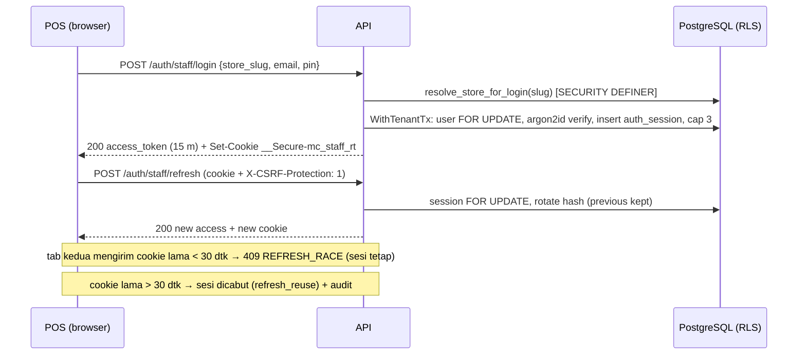
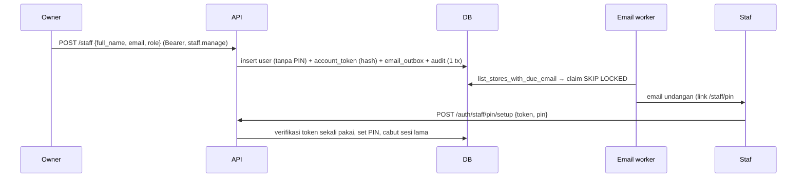

# Use Case, Alur & Sequence per Peran

Diperbarui 2026-10-31 setelah Phase 02.01-C. Menggantikan versi lama yang mendahului autentikasi.
Status: ✅ Implemented & Tested · 🔒 Guarded (503 di staging/produksi) · ⏳ Planned.
Kontrak HTTP: [docs/api/openapi.yaml](../api/openapi.yaml). Izin: `internal/pkg/rbac`.

## 1. Aktor & kelas rute (ADR-003 D8)

| Aktor | Kredensial | Rute |
| ------- | ----------- | ------ |
| Tamu (pelanggan di meja) | guest session token ⏳ | `/api/v1/public/*` ⏳; `POST /api/v1/orders` 🔒 |
| Kasir, Barista, Dapur, Owner | access token 15 menit + refresh cookie | `/api/v1/auth/staff/*`, `/api/v1/pos/*`, `/api/v1/staff/*`, `/api/v1/store/*` |
| Operator (pemilik server) | akses shell VPS | `cmd/migrate -action=bootstrap-store \| reset-owner-pin \| up \| seed` |
| Midtrans | signature SHA-512 | `POST /api/v1/payments/midtrans/webhook` ✅ |
| Worker sistem | — | rekonsiliasi pembayaran ✅, email outbox ✅, outbox relay ⏳, tutup meja ⏳ |

## 2. Use case per peran

### Tamu

| Use case | Langkah inti | Dependensi | Status |
| ---------- | -------------- | ------------ | -------- |
| Lihat menu | scan QR → katalog toko | signed QR (02.01-D), catalog API (C1) | ⏳ |
| Pesan & bayar sendiri | keranjang → order (harga dihitung server) → QRIS/e-wallet | guest session (02.01-E), payment ✅ | ⏳ |
| Pantau status | nomor antrean + diproses/siap | outbox relay + WS (Phase 03) | ⏳ |
| Struk & promo | email opsional, opt-in terpisah | R1, E4 | ⏳ |

### Kasir

| Use case | Endpoint | Izin | Status |
| ---------- | ---------- | ------ | -------- |
| Masuk/keluar, ganti PIN | `auth/staff/login \| refresh \| logout \| pin/change` | — | ✅ |
| Order walk-in / dine-in / takeaway | `POST /pos/orders` | `order.pos.create` | ✅ |
| Terima tunai, QRIS statis, EDC | `POST /pos/orders/{id}/payments` (method langsung) | `payment.tender.direct` | ✅ |
| Buat QRIS dinamis / e-wallet / VA | `POST /pos/orders/{id}/payments` (method gateway) | `payment.initiate.gateway` | ✅ (Midtrans sandbox) |
| Baca pengaturan (ambang) | `GET /store/settings` | login | ✅ |
| Shift buka/tutup, paid-out | — | `shift.open/close` | ⏳ (C1) |
| Void / refund / diskon | — | `order.void`, `payment.refund`, `order.discount.apply` + ambang | ⏳ (O1/O4/C2) |
| Open tab & split | — | `tab.manage`, `split_bill.manage` | ⏳ (T2, R4) |
| Tiket bar (bila toggle C3) | — | `kds.ticket.update.barista` | ✅ izin; ⏳ KDS |

### Barista / Dapur

| Use case | Izin | Status |
|----------|------|--------|
| Lihat & update tiket stasiunnya | `kds.ticket.read/update.{barista\|kitchen}` | ✅ izin; ⏳ endpoint |
| Tandai menu habis (minuman / makanan) | `item.availability.toggle.{beverage\|food}` | ✅ izin; ⏳ endpoint |

### Owner

Semua izin. Implemented: kelola staf, reset PIN, PIN sementara, pengaturan operasional, order & pembayaran
POS. Planned: katalog, laporan, shift review, refund di atas ambang, meja & QR, promo, loyalty, langganan.

## 3. Sequence (yang sudah berjalan)

### 3.1 Login staf, refresh, dan race antar-tab



### 3.2 Owner mengundang staf



### 3.3 Order POS + tunai

```mermaid
sequenceDiagram
    participant Kasir
    participant API
    participant DB
    Kasir->>API: POST /pos/orders {idempotency_key, order_type, items} (Bearer)
    Note right of API: store & actor dari token; store_id di body diabaikan
    API->>DB: WithTenantTx: harga dihitung ulang, stok dikunci, order + split + outbox
    API-->>Kasir: 201 order (total, nomor antrean)
    Kasir->>API: POST /pos/orders/{id}/payments {method: cash, cash_tendered_amount}
    API->>DB: payment paid (verified_by = kasir), split & order lunas, stok commit, audit CASH_PAYMENT_RECORDED
    API-->>Kasir: 200 (kembalian)
```

### 3.4 QRIS dinamis + webhook

```mermaid
sequenceDiagram
    participant Kasir
    participant API
    participant M as Midtrans
    participant DB
    Kasir->>API: POST /pos/orders/{id}/payments {method: qris}
    API->>DB: tx1: payment pending (tanpa lock saat HTTP)
    API->>M: /v2/charge (timeout 12 dtk; fallback CheckTransaction)
    API->>DB: tx2: simpan qr_string/transaction_id
    API-->>Kasir: 200 QR untuk layar pelanggan
    M->>API: webhook settlement (SHA-512)
    API->>DB: resolve_payment_webhook_context → inbox (event_hash unik) → order lunas
    Note over API,DB: bila order sudah lunas lewat metode lain → payment.refund_required (anomali)
```

## 4. Alur yang direncanakan (ringkas)

| Alur | Ringkasan | Referensi |
| ------ | ----------- | ----------- |
| QR meja → table session → guest session per perangkat → order pay-first | signed QR (key ID, versi, jeda darurat) | T1, T2, Q5, Q6 |
| Outbox relay → WS ticket → KDS/POS/TV dengan replay | `outbox_events.processed_at`, nomor urut | N1, Phase 03 |
| Shift: buka modal → transaksi → blind count → selisih > toleransi = PIN owner → Z | `store_settings.cash_variance_tolerance` | C1 |
| Void/refund: alasan + PIN sendiri; di atas ambang PIN owner; refund tunai dari laci aktif | `void_refund_owner_threshold` | O1, C2 |
| Fallback QRIS statis | gagal 2× / forced → gambar QRIS statis → konfirmasi kasir + ref | K8 |
| Katalog, varian, resep, stok bahan, promo | lihat catalog-inventory-design.md | K1, K2, K7 |

## 5. Ketergantungan modul

```text
auth (02.01-B) ─► RBAC + settings (02.01-C) ─┬─► POS order/payment ✅
                                              ├─► meja & signed QR (02.01-D) ─► guest session (02.01-E)
                                              ├─► shift & laci (C1) ─► void/refund (O1/C2) ─► split/open tab
                                              ├─► katalog C1–C4 ─► resep/stok C5 ─► HPP C7
                                              └─► outbox relay + WS ticket ─► KDS, TV antrean, layar pelanggan
email outbox ✅ ─► struk digital (R1), loyalty (K6), pengingat (K4), alert owner
```
