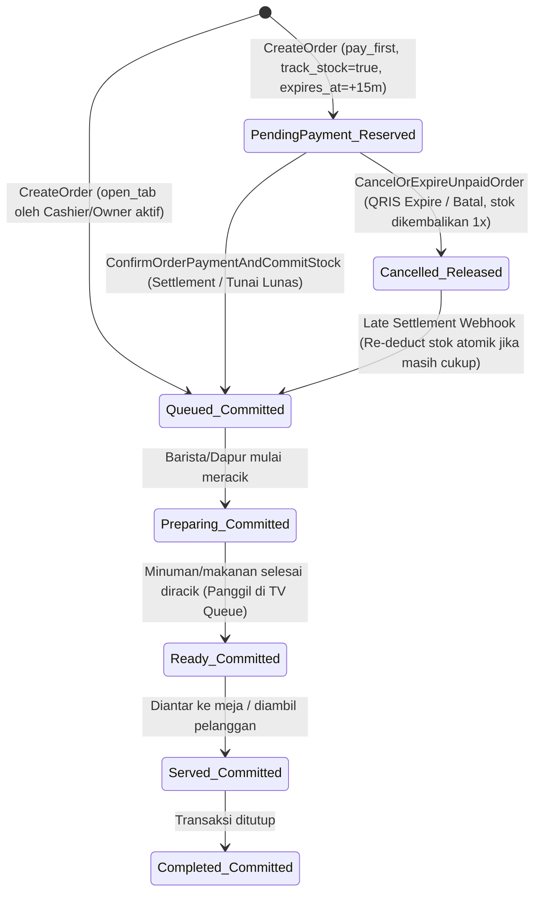
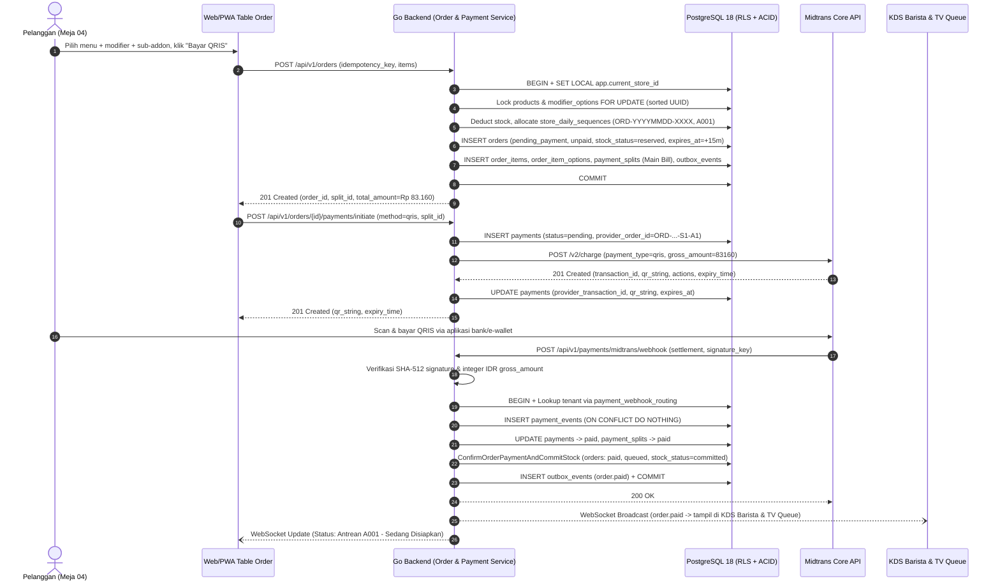
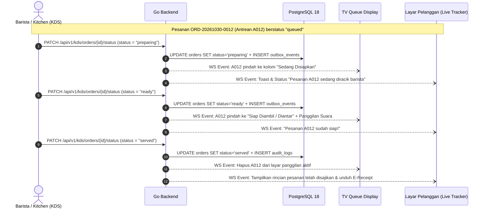

# MyCaffe Core POS: Review Use Cases, Sequence Diagrams, dan Alur Operasional End-to-End

Dokumen ini mendefinisikan use case operasional, diagram sekuens (sequence diagrams), aturan akuntabilitas kas, siklus hidup antrean, keranjang (cart), pemisahan dine-in vs takeaway, serta analitik data pemilik usaha pada **MyCaffe Core POS**.

---

## 1. Pemisahan Tegas Siklus Hidup Pesanan, Pembayaran, dan Reservasi Stok

Setiap pesanan pada MyCaffe dikelola oleh tiga state machine ortogonal yang dijaga oleh constraint PostgreSQL 18 (`CHECK` constraints):

| Dimensi State | Kolom Tabel | Nilai Valid | Tujuan Operasional |
| :--- | :--- | :--- | :--- |
| **Order Preparation Status** | `orders.status` | `pending_payment`, `queued`, `preparing`, `ready`, `served`, `completed`, `cancelled` | Mengatur visibilitas tiket pada KDS Barista/Dapur dan layar TV Queue Display. |
| **Order Payment Status** | `orders.payment_status` | `unpaid`, `pending`, `partially_paid`, `paid`, `failed`, `cancelled`, `expired`, `partially_refunded`, `refunded`, `chargeback`, `partial_chargeback` | Mengatur status pelunasan tagihan pesanan secara finansial. |
| **Stock Reservation Status** | `orders.stock_status` | `not_tracked`, `reserved`, `committed`, `released` | Mencegah *overselling* saat pelanggan masih berada di layar pembayaran QRIS tanpa menyebabkan kebocoran stok permanen (*stock leak*) jika pembayaran kedaluwarsa. |

---

## 2. Cart System, Katalog Menu, dan 1-Level Nested Sub-Addons

### 2.1 Aturan Keranjang (Client Cart vs Server Pricing Authority)
1. **Keranjang di Browser/PWA Hanya Bersifat Tampilan Sementara:**
   - Aplikasi Web/PWA menyimpan pilihan produk, opsi modifier, sub-addon, dan catatan item di memori lokal perangkat pelanggan disertai `idempotency_key` (UUID v4) yang dibangkitkan saat pelanggan menekan tombol **Bayar / Buat Pesanan**.
   - Server Go **tidak pernah** mempercayai harga dasar, nama produk, harga modifier, diskon, pajak, atau total tagihan yang dikirim dari browser.
2. **Deduplikasi Baris Item (`config_hash`):**
   - Dua item dengan `product_id` yang sama tetapi kombinasi modifier/sub-addon berbeda menghasilkan `config_hash` SHA-256 yang berbeda sehingga tercatat sebagai baris `order_items` terpisah dengan rincian `order_item_options` masing-masing.
3. **Validasi Modifier & 1-Level Sub-Addon (`ValidateAndPriceOrder`):**
   - Grup modifier bertipe `single` wajib memiliki `quantity == 1`. Pengiriman `quantity > 1` pada grup `single` ditolak dengan `ErrInvalidModifierSelection`.
   - Jika opsi induk pada grup `multiple` memiliki `quantity > 1` dan membuka grup sub-addon anak (`option_modifier_groups`), maka biaya dan kebutuhan stok sub-addon dihitung secara proporsional:
     $$\text{Total Kebutuhan Sub-Addon} = \text{ItemQty} \times \text{ParentModQty} \times \text{SubAddonQty}$$

---

## 3. Alur Dine-In (QR Meja & Open Tab) vs Takeaway (Express Counter)

| Aspek Operasional | Dine-In (`pay_first` via QR Meja) | Dine-In (`open_tab` via Kasir/Pelayan) | Takeaway (`pay_first` di Kasir / QR Counter) |
| :--- | :--- | :--- | :--- |
| **Kewajiban `table_number`** | Wajib diisi (diambil dari token tanda tangan QR meja). | Wajib diisi oleh kasir/staf. | Opsional (kosong); menggunakan `queue_number` (`A001`) sebagai identitas panggil. |
| **Otorisasi Pembuat** | Pelanggan publik (dengan signed table QR token) atau kasir. | Wajib staf aktif (`owner` atau `cashier`) yang terverifikasi di `users`. | Pelanggan publik atau kasir. |
| **Status Awal Pesanan** | `status = pending_payment`, `payment_status = unpaid`, `stock_status = reserved`. | `status = queued`, `payment_status = unpaid`, `stock_status = committed`. | `status = pending_payment`, `payment_status = unpaid`, `stock_status = reserved`. |
| **Kapan Masuk ke KDS?** | Segera setelah pembayaran terverifikasi (`payment_status = paid`). | Langsung masuk ke KDS saat pesanan dibuat (`queued`). | Segera setelah pembayaran terverifikasi (`payment_status = paid`). |

### 3.1 Sequence Diagram: QR Table Ordering (`pay_first` dengan Dynamic QRIS Midtrans)

---

## 4. Pembayaran Tunai, QRIS Statis, EDC, Akuntabilitas Kasir, dan Dual-Screen POS

### 4.1 Aturan Akuntabilitas Pembayaran Tunai & Kasir (`cash`, `static_qris`, `edc`)
1. **Otorisasi Ketat:**
   - Metode `cash`, `static_qris`, dan `edc` **hanya** dapat dieksekusi oleh staf terautentikasi dengan peran `cashier` atau `owner` pada toko tersebut. Pelanggan pada layar QR meja tidak dapat menandai pesanan mereka sendiri sebagai lunas tunai.
2. **Validasi Uang Diterima & Kembalian (`cash`):**
   - Kasir memasukkan nominal uang fisik yang diterima (`cash_tendered_amount`).
   - Backend memvalidasi `cash_tendered_amount >= split.total_amount`.
   - Kembalian dihitung di server: `change_given_amount = cash_tendered_amount - split.total_amount`.
   - Seluruh angka (`amount`, `cash_tendered_amount`, `change_given_amount`, dan `received_by_user_id`) disimpan secara permanen pada baris `payments` dan dicatat di `audit_logs`.
3. **Layar Kedua Pelanggan (Dual-Screen Cashier Display):**
   - Saat kasir menambahkan item atau memilih metode pembayaran di layar utama POS, layar kedua yang menghadap pelanggan menampilkan rincian item, modifier, pajak PB1, service charge, total tagihan (`tabular-nums`), kode QRIS (jika memilih QRIS), serta nominal uang tunai yang diterima dan kembalian secara real-time.
4. **Fleksibilitas Shift Kasir & Arus Kas (`Cashflow`):**
   - Pada mode `single_auto`, seluruh transaksi tunai harian terakumulasi otomatis pada buku kas tanggal bisnis toko (`stores.timezone`), memisahkan:
     - **Kas Masuk Penjualan Tunai:** `SUM(payments.amount) WHERE method = 'cash' AND status = 'paid'`.
     - **Penerimaan Non-Tunai Terverifikasi Gateway:** `qris`, `gopay`, `shopeepay`, `bank_transfer` (dikurangi estimasi MDR per metode untuk proyeksi pencairan bersih / *net settlement*).
     - **Penerimaan Non-Tunai Rekonsiliasi Kasir:** `static_qris` dan `edc` (wajib dicocokkan dengan struk settlement EDC/mutasi statis saat penutupan buku).
   - Pada mode `multi_shift`, setiap kasir mencatat *Opening Cash Float* (modal laci awal), kas masuk/keluar operasional (*petty cash drop/payout* dengan alasan wajib), dan *Closing Physical Cash Count* untuk mendeteksi selisih kas (*variance/discrepancy*) secara instan.

---

## 5. Kitchen Display System (KDS), Sistem Antrean TV, dan Pelacakan Pelanggan Real-Time

---

## 6. Data Analitik & Pemantauan Bisnis untuk Pemilik (Owner Analytics)

Seluruh laporan analitik pemilik dihitung dari data snapshot permanen (`orders`, `order_items`, `order_item_options`, `payments`) di dalam transaksi tenant (`store_id`) menggunakan zona waktu lokal toko (`stores.timezone`):

1. **Ringkasan Penjualan & Pendapatan Bersih (Revenue Breakdown):**
   - *Gross Sales* (`SUM(subtotal_amount)`), *Total Discount*, *Net Sales*, *Service Charge Collected*, *PB1 Tax Collected*, dan *Total Gross Collected*.
   - Estimasi biaya MDR gateway (`stores.qris_mdr_bps`) dan proyeksi dana cair bersih (*Estimated Net Payout*).
2. **Rekonsiliasi per Metode Pembayaran:**
   - Pemisahan volume dan nilai transaksi antara `qris` (dinamis Midtrans), `gopay`, `shopeepay`, `bank_transfer`, `cash`, `static_qris`, dan `edc`.
3. **Performa Menu, Modifier, dan Jam Sibuk:**
   - Produk terlaris berdasarkan kuantitas dan kontribusi pendapatan (`order_items.snapshot_name`).
   - Opsi modifier dan sub-addon paling populer (mis. persentase pelanggan yang memilih *Oat Milk Barista Blend*).
   - Distribusi kepadatan pesanan per jam (*hourly order velocity*) dan rata-rata waktu penyelesaian KDS (*queued-to-ready SLA duration*).
4. **Audit Keamanan Operasional:**
   - Daftar lengkap pesanan yang dibatalkan/kedaluwarsa (`stock_status = 'released'`), pengembalian dana (`refunded`), perubahan harga katalog, dan selisih kas shift dari tabel `audit_logs`.
